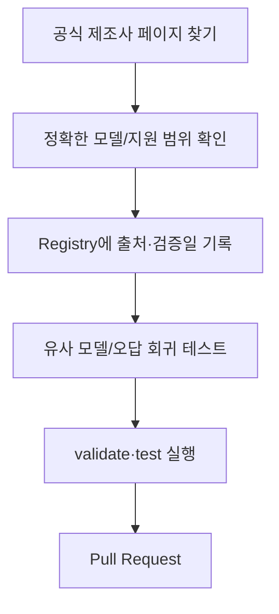

# 기여하기

이 프로젝트에 관심을 가져주셔서 감사합니다. **새로운 공식 URL 하나를 확인하는 일도 좋은 기여**입니다. 브랜드 숫자를 늘리는 것보다 *잘못된 링크를 줄이는 것*을 더 중요하게 생각합니다.

## 이런 기여를 환영합니다

- 제조사 공식 드라이버/소프트웨어 페이지 추가
- 공용 설정 프로그램의 지원 모델/제외 모델 정보 보완
- `V2`, `D4`, `WiFi`처럼 헷갈리는 모델의 오매칭 사례
- 지원이 종료된 프로그램의 공식 근거
- 잘못된 문서나 사용 예제 수정
- 새 제조사 등록을 위한 테스트

## 새 URL 하나를 등록하는 과정



**쇼핑몰이나 검색 결과에 보인 URL만으로 `verified`를 붙이지 마세요.** 실제 제조사 지원 페이지 또는 공식 소프트웨어 호환 목록의 근거가 필요합니다.

## 코드/Registry 작업 시작하기

Node.js **22 이상**을 준비한 뒤:

```bash
git clone https://github.com/HoMongYi/hardware-software-url-finder.git
cd hardware-software-url-finder
npm ci --ignore-scripts --no-audit --no-fund
node bin/hsuf.mjs registry validate
npm test
npm run validate
```

기본 테스트에는 별도 API Key나 유료 검색이 필요하지 않습니다.

## Vendor·Software Ecosystem을 추가할 때

1. 먼저 [`docs/registry.md`](docs/registry.md)에서 데이터 구조를 확인합니다.
2. 공식 제조사 사이트와 **정확 모델/리비전**의 지원 근거를 찾습니다.
3. `data/public/vendors/<id>.json`에서 `provenance`, 실제 `verified_at`, 호환 목록/제외 목록을 기록합니다.
4. 확인되지 않은 정보는 `needs-refresh`로 두고 자동 `fill`을 허용하지 않습니다.
5. 새로운 판정 규칙이나 오답 수정에는 합성 데이터를 사용한 회귀 테스트를 추가합니다.
6. Registry validate/build 및 전체 테스트를 실행합니다.

```bash
node bin/hsuf.mjs registry validate
node bin/hsuf.mjs registry build
npm test
npm run validate
```

Alias는 **제조사 근거로 같은 모델이라는 사실이 확인된 경우**에만 추가할 수 있습니다. 판매명이나 사진이 비슷하다는 이유로 `ABC`와 `ABC V2`를 합치지 않습니다.

## Pull Request에 적어주면 좋은 내용

- 어떤 모델/브랜드를 수정했는지
- 제조사 공식 근거 URL과 확인 날짜
- 적용 범위와 제외해야 하는 유사 모델
- 변경 이유 및 테스트 결과
- 실제 유료 API/브라우저 테스트를 수행했는지 여부

## 공개해서는 안 되는 데이터

회사 내부 상품번호 매핑, 검수 CSV, 고객·직원 정보, 사내 DB 주소, Private Overlay, 인증 정보, API Key·Cookie·Session은 Pull Request에 올리지 마세요. 공개 출처로 확인할 수 있는 범용 규칙만 기여할 수 있습니다.

보안 문제라면 공개 Issue에 민감한 세부 내용을 올리지 말고 [Security 안내](SECURITY.md)를 따라 주세요.

기여된 코드에는 프로젝트의 [MIT License](LICENSE)가 적용됩니다. **외부 자료를 그대로 복제할 때는 해당 자료의 재배포 조건도 별도로 확인**해야 합니다.

[← 프로젝트 README](README.md) · [문서 길잡이](docs/README.md)
