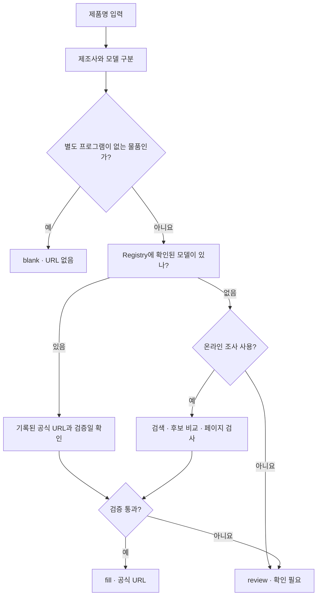
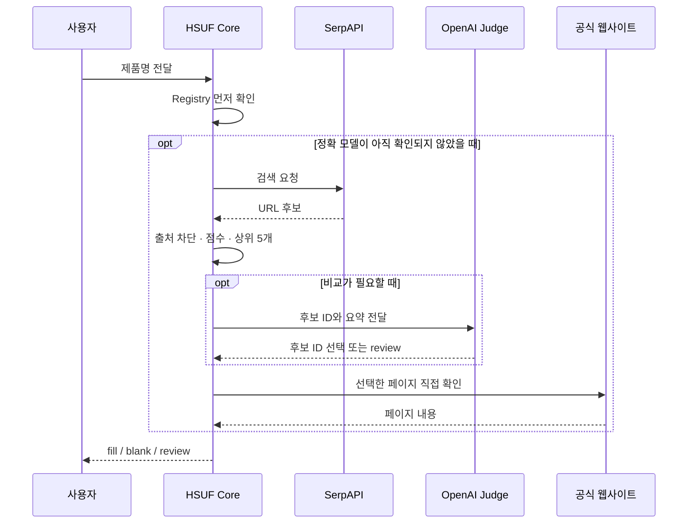

# Hardware Software URL Finder

[](https://github.com/HoMongYi/hardware-software-url-finder/actions/workflows/ci.yml) [](LICENSE) [](https://github.com/HoMongYi/hardware-software-url-finder/releases/tag/v0.1.0)

**제품명으로 공식 드라이버·설정 프로그램·지원 페이지를 찾고, 그 주소가 정확한 제품용인지 확인하는 도구입니다.**

예를 들어 메인보드 드라이버를 검색했는데 이름이 거의 같은 다른 보드의 페이지가 나오거나, 키보드 설정 프로그램을 찾다가 쇼핑몰·블로그 링크만 잔뜩 본 적이 있을 겁니다. Hardware Software URL Finder(줄여서 **HSUF**)는 그런 일을 줄이려고 만들었습니다.

PC 부품과 주변기기 모두 대상으로 하며, 특정 쇼핑몰의 상품번호나 사내 시스템이 없어도 사용할 수 있습니다. **Node.js CLI**, **CSV**, **Codex/Claude Code용 Agent Skill**, **MCP**, **HTTP API**를 제공합니다.

**[바로 사용해 보기](docs/quick-start.md)** · [AI Agent에 연결](docs/AGENTS.md) · [SerpAPI + OpenAI 설정](docs/provider-recipes.md) · [문서 모음](docs/README.md) · [v0.1.0 다운로드](https://github.com/HoMongYi/hardware-software-url-finder/releases/tag/v0.1.0)

## 제품명 하나를 넣으면

ASUS 메인보드의 제품명을 넣어보겠습니다.

```text
[ASUS] PRIME A520M-K ARGB
```

이 메인보드는 **Registry**(확인된 제조사·모델 정보 모음)에 정확한 공식 지원 페이지가 등록되어 있습니다. 그래서 별도 검색이나 AI 호출 없이 해당 페이지를 반환할 수 있습니다.

```text
https://www.asus.com/motherboards-components/motherboards/prime/prime-a520m-k-argb/helpdesk_download?model2Name=PRIME-A520M-K-ARGB
```

모델명에 붙은 `ARGB`까지 구분하므로, 이름이 비슷한 `PRIME A520M-K`를 같은 제품으로 처리하지 않습니다.

HSUF는 **검색 결과를 곧바로 정답으로 쓰지 않습니다.** 먼저 이미 확인한 공식 정보를 찾아보고, 거기서 해결되지 않는 제품만 필요에 따라 온라인으로 조사합니다.



### 결과는 세 가지입니다

| 결과 | 뜻 | URL 칸 |
|---|---|---|
| **`fill`** | 공식 출처와 해당 모델의 지원 근거가 확인됨 | 공식 URL |
| **`blank`** | 키캡·보호필름처럼 별도 소프트웨어를 연결할 필요가 없는 물품 | 비어 있음 |
| **`review`** | 모델이 애매하거나 검증 근거가 부족해서 아직 확정할 수 없음 | 비어 있음 |

**`review`는 소프트웨어가 없다는 뜻이 아닙니다.** 검색에 실패했거나 제조사 사이트에 접근할 수 없을 때도 `review`로 남깁니다. URL을 무리하게 채우는 것보다 틀린 링크를 제공하지 않는 편이 낫기 때문입니다.

> [!NOTE]
> **Offline 모드에서 `fill`이 나왔다고 해서 방금 해당 사이트에 접속했다는 뜻은 아닙니다.** 저장된 공식 근거와 `verified_at` 검증일을 바탕으로 판정합니다. 온라인 조사에서만 선택된 페이지를 새로 확인합니다.

## 직접 실행해 보기

**Node.js 22 이상**이 필요합니다. 처음 설치할 때는 npm 패키지를 내려받기 위한 인터넷 연결이 필요할 수 있지만, 아래 조회 명령은 별도 검색 API 없이 실행합니다.

```bash
git clone https://github.com/HoMongYi/hardware-software-url-finder.git
cd hardware-software-url-finder
npm ci --ignore-scripts --no-audit --no-fund
node bin/hsuf.mjs resolve "[ASUS] PRIME A520M-K ARGB" --offline
```

출력은 JSON입니다. 실제 결과에는 여러 필드가 있고, 핵심만 보면 아래와 같습니다.

```json
{
  "decision": "fill",
  "primary": {
    "url": "https://www.asus.com/motherboards-components/motherboards/prime/prime-a520m-k-argb/helpdesk_download?model2Name=PRIME-A520M-K-ARGB",
    "software_kind": "support"
  },
  "verified_at": "2026-10-01"
}
```

CSV 파일을 한 번에 처리할 수도 있습니다.

```bash
node bin/hsuf.mjs resolve examples/generic-catalog.csv --offline --output result.csv
```

`result.csv`에는 URL뿐 아니라 `decision`과 판정 이유(`reason_codes`)도 기록됩니다. 기존 시스템에 URL 세 열만 전달해야 한다면 `--legacy` 옵션을 사용할 수 있습니다. 다만 이 경우 `blank`와 `review`가 모두 빈 URL로 출력되므로 상태를 별도로 보관하는 편이 좋습니다.

```bash
node bin/hsuf.mjs resolve examples/generic-catalog.csv --offline --legacy --output legacy.csv
```

**출력 파일은 덮어쓰지 않습니다.** 같은 이름의 파일이 이미 있다면 다른 파일명을 지정해 주세요. Windows에서 실행하는 방법과 CSV 형식은 [처음 사용하기](docs/quick-start.md)에 정리했습니다.

## 모르는 제품은 어떻게 찾나요?

공개 예제는 **SerpAPI로 검색 → 잘못된 후보 제외 → 점수 계산 → 상위 5개 → 필요할 때 OpenAI로 비교 → 마지막으로 Core가 공식 페이지 확인** 순서입니다.



점수는 **정답 확률이 아닙니다.** 공식 제조사 사이트의 다른 모델 페이지처럼 점수가 높아도 틀릴 수 있는 후보는 마지막 검증에서 걸러집니다. OpenAI도 URL을 새로 만들어 확정하지 않고, 주어진 후보 중 ID를 고르는 역할만 합니다.

[온라인 조사 설정](docs/provider-recipes.md)에는 SerpAPI 키와 OpenAI 모델 설정, 실제 실행 명령이 들어 있습니다. 이 과정은 **외부 API 요금이 발생할 수 있는 선택 기능**입니다.

## 어떤 환경에서 쓸 수 있나요?

| 사용하는 환경 | 연결 방법 | 설명 |
|---|---|---|
| 터미널·엑셀용 CSV | [CLI / CSV](docs/quick-start.md) | 소량·일괄 URL 조회 |
| Codex·Claude Code | [Agent Skill](docs/AGENTS.md) | “이 CSV 확인해줘”라고 자연어로 요청 |
| MCP를 지원하는 Agent | [MCP Server](docs/AGENTS.md) | HSUF를 Agent의 Tool로 연결 |
| 웹서비스·자체 프로그램 | [HTTP API / Node.js](docs/api.md) | 입력을 보내고 JSON 결과 받기 |
| Gemini·DeepSeek·Qwen 등 | [Provider 연결](docs/providers.md) | 별도 Gateway가 HSUF 계약으로 결과 변환 |
| 상품 DB·ERP를 운영하는 조직 | [연동 가이드](docs/integration.md) | 입력/출력 Adapter를 자체 개발 |

같은 검증 규칙을 공유하지만, **어떤 AI든 Skill ZIP을 업로드하기만 하면 자동으로 인터넷 검색이 된다는 뜻은 아닙니다.** Agent마다 도구 실행 및 네트워크 권한이 다릅니다. [Agent 안내](docs/AGENTS.md)에서 설치 방식과 필요한 준비를 구분해 설명합니다.

## 무엇을 주의해서 확인하나요?

- `ABC`, `ABC V2`, `ABC WiFi`, `ABC D4`는 비슷하다고 자동으로 합치지 않습니다.
- 쇼핑몰·커뮤니티·비공식 파일 저장소·설치 파일 직접 링크는 고객용 최종 URL로 사용하지 않습니다.
- 제조사 이름만 등록되어 있다고 그 회사의 모든 제품을 같은 프로그램에 연결하지 않습니다.
- 프로그램이 중단됐거나 공식 지원 여부가 불분명하다면 `review`로 남깁니다.
- Amazon·Newegg·Taobao 같은 곳은 브랜드를 **발견**하는 데 활용할 수 있지만, 판매 페이지를 최종 소프트웨어 URL로 쓰지는 않습니다.

자세한 판정 순서는 [그림으로 보는 동작 원리](docs/workflow.md), 공식 URL을 새로 등록하는 방법은 [Registry 가이드](docs/registry.md)에 있습니다.

## 첫 공개 버전의 범위

**v0.1.0**은 범용 엔진과 연결 방식을 처음 공개한 버전입니다. Registry에는 Vendor 정의 51개, 공식 도메인 후보 85개가 있지만, 이 숫자가 곧 자동으로 URL을 찾아낼 수 있는 제품 수를 뜻하지는 않습니다. 공식 근거를 독립적으로 확인한 Exact Model은 2개이고, Software Ecosystem 24개는 `needs-refresh`라 자동 확정하지 않습니다.

기본 CLI·HTTP·MCP와 Mock Provider 테스트는 통과했습니다. **유료 SerpAPI/OpenAI 계정 실호출, Codex/Claude Code 실제 설치 UI 자동 활성화, Claude API Skill 업로드는 별도 검증 대상**입니다. npm 레지스트리에는 게시하지 않았으므로 [GitHub Release](https://github.com/HoMongYi/hardware-software-url-finder/releases/tag/v0.1.0) 또는 소스를 이용해 주세요.

<details>
<summary>더 자주 묻는 질문</summary>

**Q. 공식 URL인데 왜 `review`인가요?**

공식 도메인이라도 모델이 다를 수 있고, Registry에 지원 여부가 아직 기록되지 않았을 수 있습니다.

**Q. AI 없이도 사용할 수 있나요?**

네. `--offline`은 Registry를 조회하는 데 OpenAI나 SerpAPI 키가 필요하지 않습니다.

**Q. 우리 회사 상품번호도 사용할 수 있나요?**

네. CSV의 `input_id`에 SKU나 품목코드를 넣을 수 있습니다. 다만 사내 DB 연결과 결과 저장은 해당 시스템의 개발자가 구현해야 합니다.

</details>

오류 제보나 공식 URL 추가는 [Issues](https://github.com/HoMongYi/hardware-software-url-finder/issues)와 [기여 안내](CONTRIBUTING.md)를 참고해 주세요. 보안 문제는 [SECURITY.md](SECURITY.md)에 신고 방법을 적어두었습니다.

이 프로젝트는 개인 오픈소스이며 특정 회사의 공식 서비스가 아닙니다. 코드는 [MIT License](LICENSE)를 따릅니다.
