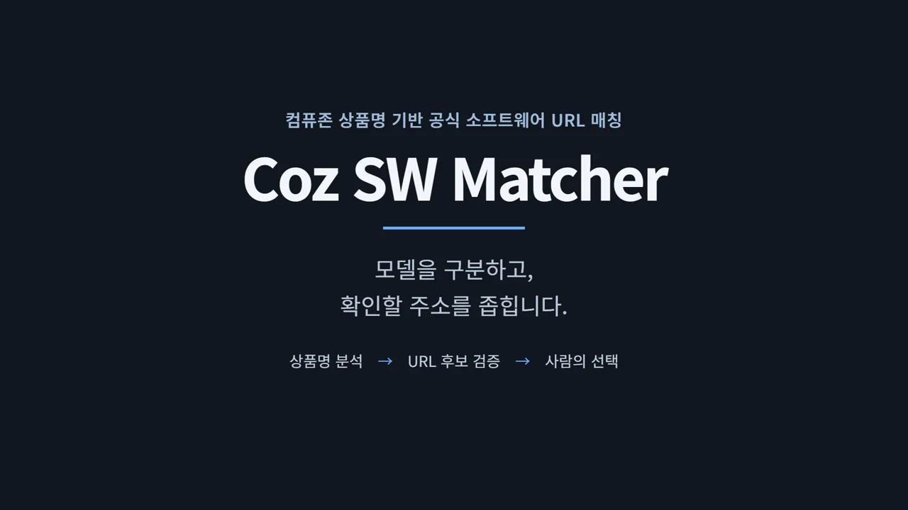
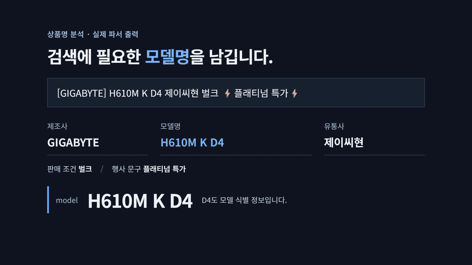
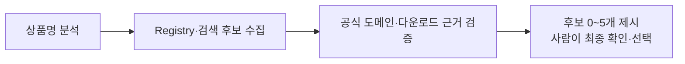

# Coz SW Matcher



[](https://github.com/HoMongYi/coz-sw-matcher/releases/download/explainer-2026-10-29/coz-sw-matcher-demo.mp4)

[45초 소개 영상](https://github.com/HoMongYi/coz-sw-matcher/releases/download/explainer-2026-10-29/coz-sw-matcher-demo.mp4) · [편집 원본 ZIP](https://github.com/HoMongYi/coz-sw-matcher/releases/download/explainer-2026-10-29/coz-sw-matcher-explainer-source.zip)

[소개 영상과 원본 안내](docs/video.md) · [시작하기](docs/quick-start.md) · [API와 연동](docs/integration.md)

Coz SW Matcher는 컴퓨존 상품명에서 제조사, 모델명, 리비전, 유통사, 행사 문구를 분석하고, 제품에 맞는 공식 소프트웨어 URL 후보를 최대 5개까지 찾아주는 도구입니다.
각 후보마다 확인 근거와 보류 사유를 함께 제공하며, 최종 URL은 사람이 직접 확인하고 선택합니다.

프로그램 실행에는 이 저장소(`coz-sw-matcher`)만 필요합니다.
소개 영상 편집 원본(`coz-sw-matcher-explainer`)은 영상을 직접 수정하거나 다시 렌더링할 때 사용하는 별도 프로젝트입니다.

독립적으로 개발한 오픈소스 프로젝트입니다.
컴퓨존이 공식 제공하거나 운영하는 서비스는 아닙니다.

## 상품명에서 무엇을 구분하나요?

상품명에는 모델명뿐 아니라 유통사, 색상, 증정품, 행사 문구가 섞여 있습니다.
이를 모델의 일부로 잘못 읽거나 과거 모델을 검색하면 다른 제품의 다운로드 페이지를 추천할 수 있습니다.

```text
[GIGABYTE] H610M K D4 제이씨현 벌크 ⚡플래티넘 특가⚡
           └ 모델 ┘ └유통사┘ └판매 조건┘ └행사 문구┘
```

파서는 `H610M K D4`를 실제 모델명으로 추출하고 나머지 정보를 분리합니다.
`D4`, `D5`, `WiFi`, `V2`, `Rev`, `OC`, `HE`, `SE+`, `PRO/MAX` 같은 세부 식별자와 규격, 용량 정보는 임의로 생략하거나 다른 모델과 합치지 않습니다.
파싱 후에도 원본 상품명은 그대로 보존합니다.

`[삼성전자] SL-M2640 흑백 레이저 프린터 ▶ SL-M2630 후속모델 ◀`에서는 현재 판매 중인 모델인 `SL-M2640`을 기준으로 삼습니다.
문구에 적힌 `SL-M2630`은 이전 모델 정보로 분류해 따로 보존합니다.

`[ASUS] DUAL 지포스 RTX 3050 O6G OC D6 6GB 인텍앤컴퍼니`처럼 하드웨어 제조사와 칩셋 제조사가 나뉜 제품은 원하는 소프트웨어 종류에 따라 대상을 구분합니다.
이 제품의 일반 SW 요청은 NVIDIA App을 우선 검토합니다.
공식 FAQ에 적힌 RTX 30 시리즈 지원 범위와 실제 다운로드 페이지를 함께 확인합니다.
보드 전용 펌웨어나 튜닝 도구를 요청하면 ASUS의 정확 모델 근거를 따로 확인합니다.

## 주소를 찾는 과정



이미 수집한 후보 URL이 있다면 이를 전달받아 검증하며, 불필요한 검색을 새로 실행하지 않습니다.
공식 도메인의 주소라도 다른 모델용이거나 미지원으로 명시된 경우는 제외합니다.
공통 앱은 공식 지원 목록과 배포 허브를 연결해 확인합니다.
설치 파일이 없는 웹 설정 도구도 지원 모델 근거와 실제 설정 화면이 확인되면 후보로 제시합니다.
최대 후보 수(5개)를 채우기 위해 기준에 맞지 않는 주소를 억지로 넣지 않습니다.

지원 범위가 확인된 후보끼리는 페이지 언어와 한국어 선택 기능을 확인해 한국어 주소를 먼저 제시합니다.
세트상품은 구성품별로 살펴봅니다.
SW가 필요한 구성품이 하나이고 나머지는 SW가 없다고 확인된 경우만 해당 구성품을 선택합니다.
여러 구성품에 SW가 있거나 하나라도 미확인이면 사람의 확인을 기다립니다.

도구가 반환하는 모든 결과의 기본 상태는 `approved=false`입니다.
`needs_human_approval`은 공식 페이지 근거가 확인된 후보가 있어 사람의 최종 선택을 기다리는 상태입니다.
`needs_review`는 모델명 일치 여부나 다운로드 링크 등 추가 확인이 필요한 상태입니다.
웹사이트 접속이 차단되었거나 검색 결과가 없다고 해서 소프트웨어가 없다고 단정하지 않고, 사람이 확인할 수 있도록 보류합니다.

## 설치하고 실행하기

Node.js 22 이상이 필요합니다.

```bash
git clone https://github.com/HoMongYi/coz-sw-matcher.git
cd coz-sw-matcher
npm ci --ignore-scripts --no-audit --no-fund
node bin/coz-sw-matcher.mjs parse "[GIGABYTE] H610M K D4 제이씨현 벌크"
node bin/coz-sw-matcher.mjs match --input examples/match-request.json
```

첫 명령의 출력에는 다음 값이 포함됩니다.

```json
{
  "manufacturer": "GIGABYTE",
  "distributor": "제이씨현",
  "model": "H610M K D4",
  "sales_attributes": ["벌크"]
}
```

두 번째 명령은 NVIDIA App 주소를 입력 후보로 전달한 예시입니다.
기본 실행은 네트워크를 쓰지 않는 오프라인 상태입니다.
이 예시는 Registry의 과거 매핑 1개를 반환하며, 현재 페이지를 확인하지 않았으므로 `status: "needs_review"`, `approved: false`로 보류합니다.
후보의 검증 상태는 `registry_recheck_required`, 실접속 날짜는 `null`입니다.
출력 전체와 네트워크를 사용하는 온라인 실행 방법은 [시작하기](docs/quick-start.md)에 있습니다.

## Agent Skill과 API

[Agent Skill](skills/coz-sw-matcher/SKILL.md)과 [에이전트 연동 안내](docs/AGENTS.md)를 제공합니다.
CLI 외에도 JavaScript, 루프백 HTTP, MCP로 사용할 수 있습니다.
입력 형식과 사람이 선택한 결과를 검증하는 방법은 [연동 문서](docs/integration.md), 서버 실행 방법은 [API 문서](docs/api.md)를 참고하세요.

```bash
node bin/coz-sw-matcher.mjs serve --port 8787
node bin/coz-sw-matcher.mjs mcp
```

## 사용 전에 알아둘 점

기본 실행은 오프라인으로 동작합니다.
네트워크 페이지 검증에는 `--online`이 필요하며, 외부 웹 검색에는 별도의 SerpAPI 키가 필요할 수 있습니다.
AI 모델을 활용한 순위 평가(Luna)는 선택 기능으로, 후보 ID의 우선순위만 재정렬하며 URL을 임의로 만들거나 승인하지 않습니다.
외부 검색과 모델 호출에는 비용이 발생할 수 있습니다.

확인되지 않은 주소는 검수 대상으로 남깁니다.
OS·리비전·펌웨어 호환성과 최종 URL은 사람이 직접 확인해야 합니다.
이 프로젝트는 선택 결과의 형식을 검증하는 역할만 하며, 사용자 인증과 저장은 연결하는 프로그램에서 구현해야 합니다.

[지원 근거와 제조사별 확인 범위](docs/support-evidence.md) · [Registry와 평가](docs/registry.md) · [보안](SECURITY.md) · [검증 범위](reports/VERIFICATION.md)

## 라이선스

[MIT](LICENSE). 현재 공개 버전은 v0.2.0입니다.
