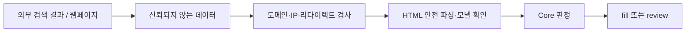

# 보안 안내

HSUF는 인터넷에서 찾아온 페이지를 분석하고, 필요할 경우 외부 검색/LLM API도 호출합니다. 그래서 **제품명·검색 결과·웹페이지 본문을 신뢰하지 않는 것**을 기본 원칙으로 삼습니다.

일반 사용자라면 아래 *핵심 보안 원칙*만 읽으면 되고, 서버나 Provider를 운영하는 개발자라면 상세 항목도 확인해 주세요.

## 핵심 보안 원칙

| 무엇을 막으려 하나요? | HSUF의 처리 방향 |
|---|---|
| 쇼핑몰·위조 드라이버 페이지를 정답으로 안내 | 공식 도메인/정확 모델/페이지 근거 확인 |
| 웹페이지에 숨겨진 '이 명령을 실행하라'는 메시지 | 웹페이지를 명령이 아닌 **검증할 데이터**로 취급 |
| URL을 이용한 사설 IP/내부 서버 접근 | DNS·리다이렉트 단계의 SSRF 차단 |
| AI가 후보에 없는 새 링크를 생성 | Judge는 후보 ID만 선택, Core Audit가 최종 결정 |
| 조직별 상품 DB나 API Key 공개 | Public Registry/Release에서 제외 |

## 외부 Provider에 어떤 정보가 넘어가나요?

Search/Judge는 정규화한 제조사·모델·카테고리와 제한된 후보 제목/요약 등 작업에 필요한 범위만 받습니다. `input_id`, 임의의 `metadata`, Private Overlay 원본, 회사 내부 테이블은 Provider로 전달하지 않습니다.

> [!IMPORTANT]
> **상품명 자체가 외부에 공개하면 안 되는 데이터일 수도 있습니다.** 비공개 신제품·내부 SKU나 고객식별정보가 상품명에 포함될 가능성이 있는 조직이라면 외부 Provider를 켜기 전에 자체 보안 정책을 검토해야 합니다.

## URL/네트워크 방어

HSUF의 네트워크 Fetcher에는 다음 제한이 있습니다.

- `http`/`https`만 허용하며 URL 안의 사용자 이름/비밀번호를 거절합니다.
- 루프백·RFC1918 사설 IPv4·link-local·metadata·CGNAT·예약/멀티캐스트 IP 및 비공개 IPv6 등을 차단합니다.
- 호스트 DNS 응답을 검사하고 검증한 IP로 연결을 고정해 DNS Rebinding 위험을 줄입니다.
- 모든 리다이렉트 대상에 대해 재검사합니다. HTTPS 다운그레이드를 거절하고 다른 Origin에 자격증명을 넘기지 않습니다.
- 외부 요청은 **총 12초 제한**, 디코딩 본문 **1 MiB 제한**, **최대 4회 리다이렉트**를 기본으로 사용합니다.
- 압축된 응답을 거절하고 `Accept-Encoding: identity`를 사용합니다.
- 로그인/CAPTCHA/Anti-bot 우회를 구현하지 않으며 실행 파일·펌웨어 바이너리 다운로드를 실행하지 않습니다.

Offline 판정에서는 네트워크 요청이 필요하지 않습니다.

## 웹페이지와 Prompt Injection

공식 도메인인 것처럼 보이는 페이지에 악의적인 문장이 있을 수 있습니다. HSUF는 웹페이지에 쓰인 지시를 실행하지 않고 제품/소프트웨어 근거만 추출합니다. Judge는 **기존 후보 ID**만 선택할 수 있으며 Core가 최종 페이지를 독립적으로 확인합니다.

HTML은 JavaScript를 실행하지 않는 DOM 파서로 처리합니다. `script`, `style`, `template`, `noscript`, `iframe`, hidden/aria-hidden, 인라인 `display:none`·`visibility:hidden`·`opacity:0` 하위 콘텐츠는 근거에서 제외합니다.

다만 이것은 **브라우저 렌더링이 아닙니다.** 외부 CSS나 JavaScript로 뒤늦게 나타나는 지원 목록은 자동 검증하지 못할 수 있어 `review` 또는 사람 검수 대상이 됩니다.

## HTTP / MCP 운영 시

HTTP API는 기본적으로 루프백에만 바인딩합니다. 브라우저 `Origin`과 예상하지 못한 `Host` 헤더를 차단합니다. 루프백 이외 주소에 노출하려면 `HSUF_HTTP_TOKEN`과 Bearer 인증이 필요합니다.

JSON 본문은 최대 **1 MiB**, 배치는 **1,000개**, 기본 동시 요청은 **2개**로 제한하고 과부하 시 429를 반환합니다. 원격 서비스로 운영한다면 **TLS, Reverse Proxy, 접근 제어, Rate Limit, Secret 보관, 서비스 격리** 등은 운영자가 추가로 설계해야 합니다.

MCP 기본 Tool은 읽기 전용입니다. 온라인 `research_hardware_software_url`은 웹 요청과 API 비용이 생길 수 있어 별도로 노출됩니다. MCP stdio 버퍼는 1 MiB로 제한합니다.

## Command Judge와 로컬 Config

Command Judge는 신뢰한 관리자가 지정한 실행 파일을 shell 없이 실행합니다. 안전한 최소 OS 환경변수만 전달하고 시간·stdout/stderr 크기를 제한합니다. **운영자가 작성한 프로그램 실행 기능이지, 악성 코드를 가두는 샌드박스는 아닙니다.** 신뢰할 수 없는 YAML Pipeline/명령 설정은 로드하지 마세요.

## 공개 데이터와 배포

API Key·Cookie·세션·내부 DB 덤프·고객/직원 정보·Private Overlay를 공개 Registry와 GitHub Release에 넣지 않습니다. `.env.example`에는 변수명만 넣고 실제 값은 저장하지 않습니다. Public Release는 명시적 파일 허용목록을 사용하고 Symlink를 거절합니다.

저장소의 Secret/Private 검사 도구는 알려진 패턴을 대상으로 하므로 **모든 종류의 민감정보 발견을 보장하지는 않습니다.** 공개 출처 및 최종 파일 목록도 유지관리자가 검수해야 합니다.

## 취약점을 발견했다면

GitHub 저장소 **Security 탭의 Private Vulnerability Reporting**이 활성화되어 있다면 이를 이용해 주세요. 사용할 수 없다면 [GitHub Issues](https://github.com/HoMongYi/hardware-software-url-finder/issues)에 **비공개 연락 채널을 요청하는 최소한의 글**만 남겨 주세요.

**실제 API Key, 고객정보, 취약한 운영 서버 URL이나 실행 가능한 공격 상세내용은 공개 Issue에 올리지 마세요.** 버전과 증상 개요를 먼저 전달한 뒤 합의된 비공개 채널에서 재현 정보를 공유해 주세요.

[← 프로젝트 README](README.md) · [개발자용 문서](docs/README.md)
