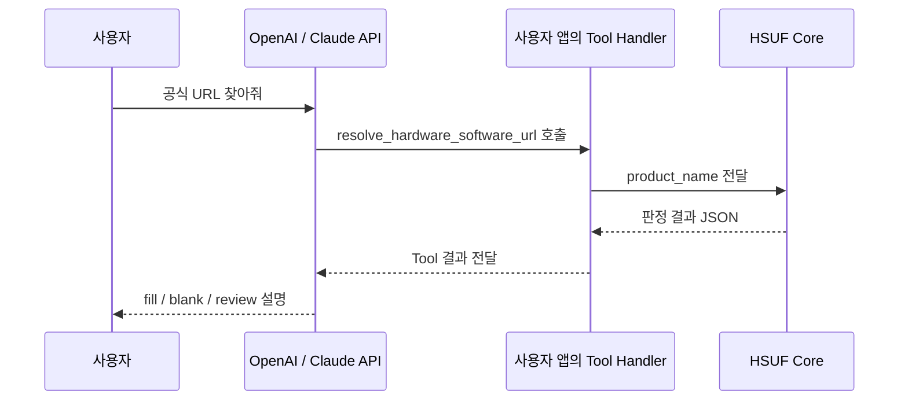

# Codex·Claude Code·AI Agent에서 사용하기

터미널에 명령을 직접 입력하는 대신, AI에게 **“이 CSV에서 공식 드라이버 주소를 찾아줘”**라고 시키고 싶을 때 사용하는 방법입니다.

HSUF에는 두 가지 연결 방식이 있습니다.

- **Agent Skill:** AI에게 URL을 어떤 순서로 조사하고 언제 HSUF를 실행해야 하는지 알려주는 사용 설명서입니다.
- **MCP Server:** AI가 HSUF 기능을 **도구(Tool)**로 호출할 수 있게 연결합니다.

둘 중 하나만 써도 됩니다. 익숙한 Agent가 로컬 명령을 실행할 수 있다면 Skill+CLI가 간단하고, 여러 Agent에서 같은 기능을 공유하려면 MCP도 고려할 수 있습니다.


## 1. Codex에서 사용하기

먼저 프로젝트를 준비합니다. [처음 시작하기](QUICK_START.md)에서 Node.js 설치와 `npm ci`까지 확인하세요.

Canonical Skill 폴더는 저장소의 아래 위치에 있습니다.

```text
skills/hardware-software-url-finder/
  SKILL.md
  scripts/
  references/
```

Codex에서 Skill을 프로젝트별로 두려면 `.agents/skills/hardware-software-url-finder`로 복사하고, 개인 환경에 두려면 `~/.agents/skills/hardware-software-url-finder`로 복사할 수 있습니다. 여기서 **Skill은 프로그램 전체를 대신하지 않으므로**, HSUF Core도 설치되어 있어야 합니다.

Skill wrapper가 Core를 찾을 수 있도록 `HSUF_HOME`을 소스 프로젝트의 절대경로로 설정합니다.

**Windows PowerShell 예시:**

```powershell
$env:HSUF_HOME = 'C:\work\hardware-software-url-finder'  # 실제 폴더로 변경
node "$env:HSUF_HOME\skills\hardware-software-url-finder\scripts\hsuf.mjs" resolve "[Canon] PIXMA E3470" --offline
```

설치 후 Codex에 이런 식으로 지시할 수 있습니다.

> hardware-software-url-finder 스킬을 사용해 `products.csv`의 공식 소프트웨어 URL을 확인해줘. 먼저 Offline Registry로 검사하고, 확인되지 않은 건 review로 구분해줘. 원본 CSV는 덮어쓰지 마.

[Release](https://github.com/HoMongYi/hardware-software-url-finder/releases/tag/v0.1.0)에는 Codex Plugin ZIP도 있습니다. 플러그인 번들에는 Skill·MCP 설정과 runtime이 포함되지만, **Codex UI에서 자동 설치·활성화되는 전체 흐름은 v0.1.0에서 실사용 검증되지 않았습니다.** 설치 메뉴/경로는 사용하는 Codex 버전의 공식 안내를 확인하세요.

플러그인 ZIP에는 Node.js와 의존성이 들어 있지 않습니다. Node.js 22 이상을 설치하고, 압축을 푼 `hardware-software-url-finder/runtime/`에서 `npm ci --ignore-scripts --no-audit --no-fund`를 실행해야 합니다.

## 2. Claude Code에서 사용하기

Claude Code도 같은 Canonical Skill을 사용합니다. 별도 판단 규칙을 만들 필요가 없습니다.

| 범위 | Skill 경로 |
|---|---|
| 프로젝트에서만 | `.claude/skills/hardware-software-url-finder/` |
| 본인 환경 전체 | `~/.claude/skills/hardware-software-url-finder/` |

Skill 폴더를 복사한 후 Core 설치 및 `HSUF_HOME`을 확인합니다. 자연어 요청 예시:

> 이 키보드 목록에서 `V2`, `Pro`, `WiFi` 같은 모델명을 절대 임의로 합치지 말고 공식 프로그램 URL을 조사해줘. 정확한 근거가 없으면 review CSV로 분리해줘.

> [!NOTE]
> 이 프로젝트는 동일한 Agent Skill 포맷과 로컬 wrapper를 제공합니다. Claude Code의 실제 UI에서 Skill이 자동 선택되는지는 설치 환경에 따라 확인이 필요합니다.

## 3. MCP로 연결하기

Agent가 외부 MCP Server를 연결할 수 있다면, HSUF를 Tool로 제공할 수 있습니다.

```bash
node bin/hsuf.mjs mcp
```

**기본 MCP는 Offline**입니다. 제품 조회·감사·Registry 상태 조회를 제공합니다.

MCP 설정 형식은 앱마다 다르지만, 개념적으로는 다음과 같습니다.

```json
{
  "mcpServers": {
    "hsuf": {
      "command": "node",
      "args": ["/absolute/path/to/hardware-software-url-finder/bin/hsuf.mjs", "mcp"]
    }
  }
}
```

이 JSON은 **MCP 호스트에서 해당 형식을 지원할 때 사용하는 예시**이며, Codex의 모든 버전에서 그대로 붙여넣는 공용 설정은 아닙니다. 호스트별 MCP 설정 규칙을 확인하세요.

기본 Tool에는 `resolve_hardware_software_url`, `resolve_hardware_software_urls`, `audit_hardware_software_url`, `lookup_hardware_vendor`, `lookup_software_ecosystem`, `get_registry_status`가 포함됩니다.

별도 온라인 조사를 허용하려면:

```bash
node bin/hsuf.mjs mcp --pipeline serpapi-openai-judge
```

이 경우 `research_hardware_software_url` Tool이 추가됩니다. **온라인 검색·LLM 호출은 요금이 발생할 수 있으므로** 사용자의 요청과 Provider 설정을 확인하고 사용하세요. 기본 `resolve_*` Tool은 여전히 Offline입니다.

## 4. OpenAI API·Claude API 프로그램에서는?

API만 호출한다고 로컬 Skill이 자동으로 설치되는 것은 아닙니다. 애플리케이션이 HSUF Core에 연결되는 **도구 호출 코드를 작성해야 합니다.**



저장소의 [`examples/agent-api-bridge.mjs`](../examples/agent-api-bridge.mjs)는 OpenAI `function_call`과 Claude `tool_use`를 공통 Core로 연결하는 handler 예제입니다. **전체 API 대화 루프나 외부 유료 호출을 대신 구현한 SDK 샘플은 아닙니다.**

```js
import { handleOpenAI, handleClaude } from './examples/agent-api-bridge.mjs';

const openaiToolResult = await handleOpenAI({
  name: 'resolve_hardware_software_url',
  call_id: 'sample-1',
  arguments: JSON.stringify({ product_name: '[Canon] PIXMA E3470' })
});

const claudeToolResult = await handleClaude({
  name: 'resolve_hardware_software_url',
  id: 'sample-2',
  input: { product_name: '[Canon] PIXMA E3470' }
});
```

Claude API의 Skill code-execution 컨테이너에서는 외부 네트워크 접근 제약이 있으므로, 라이브 URL 조사는 **호스트 애플리케이션의 Tool/MCP → HSUF Core** 쪽에서 처리하도록 설계하는 편이 안전합니다.

## 5. Agent가 잘 쓰도록 요청하는 법

간단한 요청에서도 아래 조건을 같이 알려주면 결과를 검수하기 편합니다.

- **입력:** CSV 파일 또는 제품명
- **출력:** 업데이트 CSV + `review` 항목
- **기준:** 제조사 공식 URL, 정확한 모델/리비전, 추정 금지
- **옵션:** Offline만 사용할지, 비용 발생 가능한 온라인 검색도 허용할지

예를 들면:

> HSUF를 사용해서 `products.csv`의 공식 소프트웨어 URL을 찾아줘. 우선 Offline으로 처리하고, Registry에서 확인되지 않은 제품은 온라인 조사 여부를 별도로 표시해줘. 모델명이 비슷하다는 이유로 합치지 말고 `fill/blank/review`와 근거를 포함해 줘. 원본은 유지해줘.

[← 문서 길잡이](README.md) · [MCP·HTTP 규격](API.md) · [온라인 조사 설정](PROVIDER_RECIPES.md)
