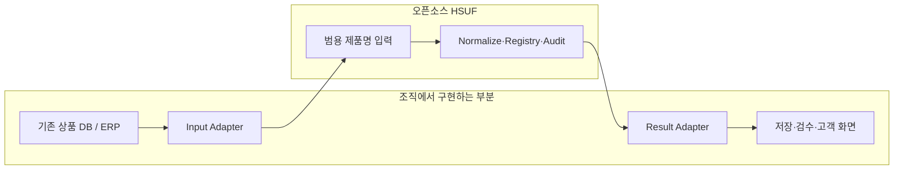
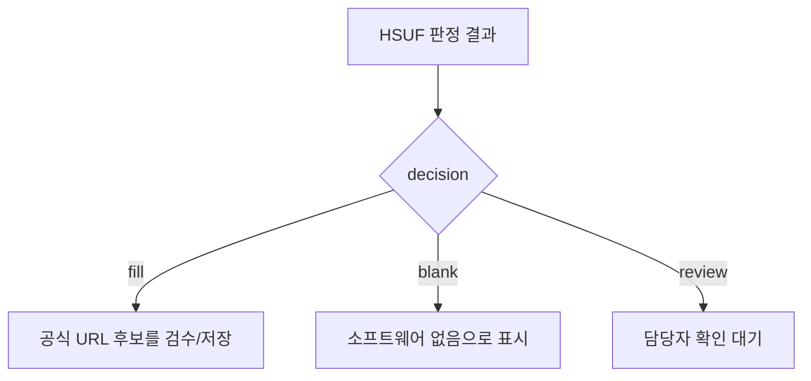

# 기존 상품 DB·ERP·웹서비스에 붙이는 방법

**HSUF를 사용하려고 기존 시스템을 갈아엎을 필요는 없습니다.** 가지고 있는 상품명 데이터를 HSUF 입력 형식으로 전달하고, 돌아온 판정 결과를 필요한 곳에 저장하거나 검수하면 됩니다.

이 문서는 어느 회사나 참고할 수 있게 작성했습니다. 특정 업체의 사내 DB 테이블·인증·ERP API를 알거나 추측하지 않습니다.

## 서로 무엇을 맡나요?



현업 담당자는 **어떤 URL을 신뢰할지, 어떤 경우 검수로 돌릴지**를 정의할 수 있습니다. DB 조회·저장, 배치 작업, 접근 권한, 운영 서버 설정 등은 각 조직의 개발팀에서 판단합니다.

## 1. 입력 변환

기존 데이터가 다음처럼 생겼다고 가정하겠습니다. **설명용 가상 데이터**입니다.

```json
{ "sku": "A-100", "item_name": "[ASUS] PRIME A520M-K ARGB" }
```

개발자는 이를 HSUF가 이해하는 공통 입력으로 변환합니다.

```json
{
  "input_id": "A-100",
  "product_name": "[ASUS] PRIME A520M-K ARGB",
  "category": "motherboard"
}
```

`input_id`는 임의의 회사 상품코드를 넣어도 됩니다. HSUF가 이 값을 실제 상품번호로 조회하는 것은 아닙니다.

## 2. 판정 호출

호출 방식은 운영 환경에 따라 고를 수 있습니다.

| 환경 | 보통 적합한 방식 |
|---|---|
| CSV 파일을 주기적으로 수집/검수 | CLI Batch |
| 기존 Node.js 서비스 내부에서 사용 | `createEngine()` Library |
| 다른 언어나 서버에서 호출 | HTTP API |
| 사내 AI Agent에게 Tool 제공 | MCP |

DB에 종속되지 않는 샘플은 [`examples/integration-adapter.mjs`](../examples/integration-adapter.mjs)를 참고하세요. 예제의 `readCatalog()`와 `acceptResult()`는 **각 조직이 구현해야 하는 부분**입니다.

## 3. 결과 보관

HSUF는 다음 상태를 반환합니다.



`fill` 결과도 서비스 정책에 따라 최종 승인자가 확인할 수 있습니다. **`review`를 `blank`로 합치지 않는 것**이 중요합니다. Legacy CSV에서는 두 상태 모두 URL이 비어 있으므로 기본 CSV의 `decision`을 따로 보관하세요.

## 4. 내부 확정값이 이미 있다면

회사에서 검수한 데이터가 있다면 **Private Overlay**로 운영할 수 있습니다. 예제는 `data/private/`처럼 Git에서 제외된 경로를 권장합니다.

```bash
node bin/hsuf.mjs resolve products.csv --private data/private --offline
```

Overlay는 공개 Registry와 같은 Schema를 사용하고, 명시적으로 경로를 지정했을 때만 로드합니다. 비공개 SKU·고객정보·사내 운영 로그는 공개 저장소/Release에 포함하지 않습니다.

Private Overlay의 공개 권한·백업·접근 제어는 조직이 관리해야 합니다. `input_id`, `metadata`와 Private 원본은 Search/Judge에 그대로 전달하지 않습니다. **상품명 자체가 민감할 수 있는 환경이라면 외부 Research Provider 사용 전에 반드시 보안 검토**가 필요합니다.

## 5. 이미 URL 검색 시스템을 운영하고 있다면

기존에 `검색 API → 후보 점수 → LLM 선택` 시스템이 있어도 전부 버릴 필요가 없습니다.

```text
기존 검색 시스템의 후보
        ↓
HSUF Search/Judge Contract에 맞춰 변환
        ↓
HSUF Core의 최종 URL Audit
        ↓
fill / review
```

검색 방식과 모델을 유지하면서 **정확 모델·공식 도메인·검증일 기준만 공통화**할 수 있습니다.

**주의:** `fill`이 사내 DB에 자동 반영되어야 하는지, 검수자 승인을 거쳐야 하는지, 재검증 시기와 롤백은 어떻게 할지는 HSUF가 결정하지 않습니다. 그 조직의 운영 정책과 개발팀 역할입니다.

[← 문서 길잡이](README.md) · [API 계약](API.md) · [판정 흐름](WORKFLOW.md)
