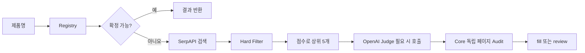
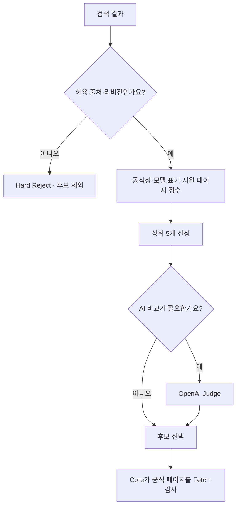

# SerpAPI + OpenAI로 모르는 제품 조사하기

HSUF는 처음부터 모든 제품을 검색하지 않습니다. **이미 Registry에서 해결한 제품은 그대로 사용하고, 확인되지 않은 제품만 외부에서 찾습니다.** 이 문서는 공개 v0.1.0의 `serpapi-openai-judge` 예제를 실제 실행할 때 필요한 내용을 정리했습니다.

## 우선 구조부터 보기



## 준비물

- [처음 시작하기](QUICK_START.md)에 따라 HSUF 설치
- SerpAPI 계정의 API Key
- OpenAI API Key와 **본인 계정에서 실제 사용할 수 있는 모델 ID**
- 외부 API 사용에 따른 비용을 감수할 수 있는 환경

**온라인 검색이 작동하려면 제조사가 Registry에서 식별되고 공식 도메인 정보도 있어야 합니다.** 제조사 자체가 미등록인 제품은 검색 Provider를 설정해도 곧바로 조사하지 못하고 `review`가 될 수 있습니다. 공식 도메인을 먼저 검증해 Registry에 등록하는 절차는 [Registry 안내](REGISTRY.md)를 참고하세요.

기본 Offline 모드에는 위 키가 필요하지 않습니다. **유료 Provider의 실제 계정 호출은 프로젝트 v0.1.0 릴리즈 테스트에서 실행되지 않았습니다.** 설정과 입출력 계약은 테스트되어 있지만 실제 사용 전에 소량 샘플로 점검하는 것을 권장합니다.

## 1. 환경변수 설정

**Windows PowerShell:**

```powershell
$env:SERPAPI_API_KEY = '<serpapi-api-key>'
$env:OPENAI_API_KEY = '<openai-api-key>'
$env:OPENAI_MODEL = '<available-model-id>'
```

**macOS / Linux:**

```bash
export SERPAPI_API_KEY='<serpapi-api-key>'
export OPENAI_API_KEY='<openai-api-key>'
export OPENAI_MODEL='<available-model-id>'
```

실제 키를 문서나 GitHub에 남기지 마세요. HSUF는 `.env` 파일을 자동 로드하지 않으므로 실행 환경에서 전달해야 합니다.

## 2. 작은 CSV로 실행

```bash
node bin/hsuf.mjs resolve examples/generic-catalog.csv \
  --pipeline serpapi-openai-judge \
  --output research-result.csv
```

PowerShell에서는 한 줄로 작성하면 줄연결 문자 차이를 신경 쓰지 않아도 됩니다.

```powershell
node bin/hsuf.mjs resolve examples/generic-catalog.csv --pipeline serpapi-openai-judge --output research-result.csv
```

기존 파일을 덮어쓰지 않으므로 파일명이 중복되면 바꿔주세요. `--config examples/serpapi-openai-judge.example.yaml`도 제공됩니다.

> [!IMPORTANT]
> 이 예제 CSV는 Registry에서 확인된 제품도 포함합니다. 그런 제품은 검색·Judge를 건너뜁니다. **온라인 기능을 제대로 시험하려면 공개 출처와 개인정보 조건을 만족하는 미확인 제품을 소량으로 추가**해보세요.

## 3. 점수제는 무엇을 하나요?

검색 결과에서 쇼핑몰·커뮤니티·파일 직접 링크·명백한 잘못된 리비전은 **점수 계산 전에** 제거합니다. 이후 공식 도메인/모델명/다운로드 페이지 신호 등으로 점수를 계산해 기본 **상위 5개 후보**를 고릅니다.

예시 정책은 [`config/scoring.yaml`](../config/scoring.yaml), 후보 개수는 [`examples/serpapi-openai-judge.example.yaml`](../examples/serpapi-openai-judge.example.yaml)에서 확인할 수 있습니다.



여기서 **점수 95점 = 정답 95%**가 아닙니다. 점수는 후보 우선순위일 뿐이고, 마지막 검증을 통과해야 합니다.

## 4. OpenAI가 무엇을 하나요?

Judge가 호출되면 제품 모델명과 후보의 ID·URL·제목·점수 등을 비교해 후보 ID 하나를 제안하거나 `review`를 반환합니다. **AI가 새로운 URL을 만들어 최종 결과에 끼워 넣지는 못합니다.**

후보 하나만 남거나 Registry에서 이미 결정한 경우 등에는 Judge 호출을 생략할 수 있습니다. OpenAI가 특정 후보를 골라도 마지막 Core Audit가 실패하면 `review`로 돌아갑니다.

## 5. 비용을 줄이려면

외부 호출을 늘리기 전에 공개 Registry 데이터와 기존 모델의 정확성을 먼저 확인하는 편이 좋습니다. HSUF는 Registry-first 방식과 동일 모델의 배치 중복 제거를 지원합니다.

**단, 호출당 실제 요금은 SerpAPI/OpenAI의 사용 모델·요금제에 따라 달라집니다.** README나 코드에 고정된 예상 비용을 적지 않습니다.

## 자주 겪는 결과

| 상태 또는 코드 | 의미 | 다음 행동 |
|---|---|---|
| `REGISTRY_MISS` | 현재 확인된 모델 정보가 부족함 | 온라인 조사 고려 |
| `SEARCH_PROVIDER_UNCONFIGURED` | 검색 Provider가 구성되지 않음 | Pipeline/키 점검 |
| `SEARCH_PROVIDER_FAILURE` | 검색 단계에서 오류 | 권한·요금·네트워크 확인 |
| `JUDGE_PROVIDER_FAILURE` | Judge 호출/응답 오류 | 모델 ID/키/응답 형식 확인 |
| `CORE_FETCH_FAILURE` | 최종 페이지를 Core가 확인하지 못함 | 공식 페이지 수동 점검 |
| `EXACT_MODEL_UNVERIFIED` | 페이지에서 정확 모델 근거가 확인되지 않음 | 다른 공식 후보 확인 |

Provider 오류는 `blank`가 아닙니다. **검증 실패를 '별도 소프트웨어가 없음'으로 해석하지 마세요.**

[← 전체 문서](README.md) · [고급 Provider 계약](PROVIDERS.md) · [판정 원리](WORKFLOW.md)
