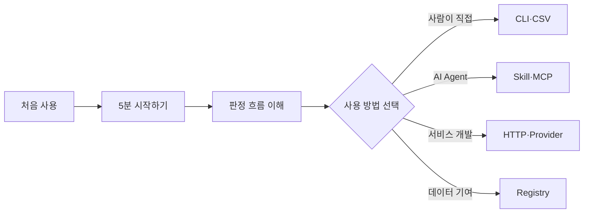

# HSUF 문서 길잡이

설치부터 API 연동까지 한 페이지에 다 담으면 필요한 설명을 찾기 어렵습니다. 지금 하려는 작업에 맞는 문서부터 보시면 됩니다.

| 궁금한 내용 | 어디서 보면 되나요? |
|---|---|
| 설치하고 제품 하나 찾아보기 | [QUICK_START.md — 5분 시작하기](quick-start.md) |
| `fill`, `blank`, `review`가 나오는 과정 | [WORKFLOW.md — 그림으로 보는 원리](workflow.md) |
| Codex, Claude Code, MCP로 사용하기 | [AGENTS.md — AI Agent 사용법](AGENTS.md) |
| SerpAPI + OpenAI Judge 설정하기 | [PROVIDER_RECIPES.md — 온라인 조사 따라 하기](provider-recipes.md) |
| Gemini·DeepSeek·Qwen·자체 Agent 붙이기 | [PROVIDERS.md — 연결 규격](providers.md) |
| HTTP API, MCP, CLI 입력과 응답 | [API.md — 개발자용 인터페이스](api.md) |
| 회사의 SKU/ERP/DB와 연결할 때 | [INTEGRATION.md — 조직 연동](integration.md) |
| 새 제조사/프로그램 등록, `needs-refresh` | [REGISTRY.md — Registry 운영](registry.md) |
| 낯선 용어를 빠르게 찾아보기 | [GLOSSARY.md — 용어 설명](glossary.md) |
| 공식 표준 문서·검증 자료 | [OFFICIAL_SOURCES.md — 외부 참고문서](official-sources.md) |
| 배포 파일의 차이와 버전 안내 | [RELEASES.md — 무엇을 내려받을지](releases.md) |

## 순서가 헷갈린다면

처음이라면 [5분 시작하기](quick-start.md)부터 읽는 것을 권장합니다. 단순히 URL을 찾는 작업이라면 개발자용 API 문서까지 볼 필요는 없습니다.

[← 프로젝트 README로 돌아가기](../README.md)
