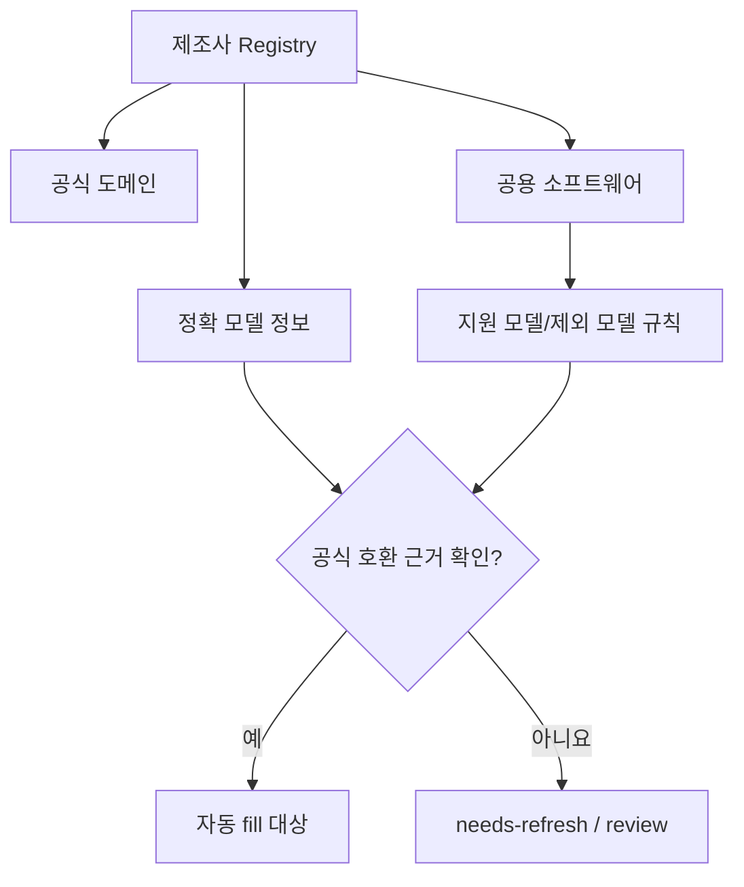
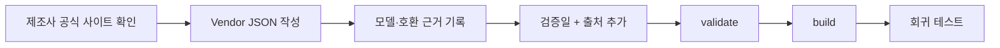

# Registry — 이미 알고 있는 공식 정보를 쌓는 곳

제품을 하나 찾을 때마다 검색하면 느리고 비용도 들고, 같은 제품에서 매번 다른 답이 나올 수 있습니다. 그래서 HSUF는 **검증된 제조사·모델·소프트웨어 정보를 Registry에 쌓아 두고 먼저 조회**합니다.

## 등록된 브랜드가 많아도 URL이 안 나올 수 있어요

예를 들어 `VGN`이라는 브랜드의 공식 홈페이지를 알아냈다고 해서, **VGN 제품 전체가 같은 프로그램을 쓴다고 결론내릴 수는 없습니다.** 모델마다 전용 프로그램이나 Web Driver가 다를 수 있기 때문입니다.



브랜드만 알려진 항목, 확인되지 않은 공용 소프트웨어, 정확 모델 기록을 **서로 구분**합니다. 그렇기 때문에 Registry에 브랜드 이름이 있어도 `review`는 정상적인 결과일 수 있습니다.

## 어디에 기록하나요?

사람이 수정하는 원본은 `data/public/vendors/*.json`입니다.

```text
data/public/
  vendors/
    asus.json
    vgn.json
    ...
  registry.compiled.json   ← 빌드된 파일
```

개별 제조사 파일을 편집한 뒤 **Schema 검사 → 충돌 검사 → Registry 빌드**를 진행합니다. 생성된 `registry.compiled.json`을 직접 고치지 마세요.

## 제조사 하나 추가하는 흐름



처음에는 [가상 제조사 예제](../examples/vendor.example.json)를 보고 형식을 확인하세요. 가상 예제 도메인을 실제 업체의 공식 URL처럼 등록하지 않도록 주의합니다.

공식 지원 페이지를 찾았다면 레코드에 출처 URL(`provenance`)과 실제 확인 날짜(`verified_at`)를 기록합니다. 검증하지 않은 URL은 `active`라고 해두면 안 됩니다.

## 어떤 날짜와 상태를 쓰나요?

| 상태 | 의미 | 자동 `fill` 가능 여부 |
|---|---|---|
| `active` | 공식 근거가 있고 현재 지원 상태로 확인됨 | **정확 모델·검증일·감사 통과 시에만** 가능 |
| `needs-refresh` | 지원 여부/최신 상태를 다시 확인해야 함 | 불가 |
| `deprecated` | 더 이상 권장되지 않음 | 불가 |
| `retired` | 지원 종료 | 불가 |
| `replaced` | 다른 소프트웨어로 대체 | 불가 (후속 프로그램도 별도 근거 필요) |

기본적으로 **180일**보다 오래된 검증 정보는 다시 확인해야 합니다(레코드의 `max_age_days`로 조정 가능). `verified_at`은 프로그램을 실행했다고 바뀌지 않습니다.

공식 URL이 아직 열리더라도 소프트웨어가 종료됐을 수 있으므로 **HTTP 200만으로 `active`를 정하면 안 됩니다.**

## 정확 모델과 Alias

`ABC`, `ABC V2`, `ABC WiFi`, `ABC D4`는 이름이 비슷해도 지원 도구가 다를 수 있습니다. HSUF는 모델 식별에 중요한 토큰을 보존합니다.

같은 모델이 국내 판매명과 글로벌 판매명으로 다르게 표기됐다면 `model_aliases`를 사용할 수 있습니다. 다만 **제조사 공식 문서 등으로 동일 모델임이 확인된 경우에만**, 해당 제조사 범위 안에서 등록하세요. 추측 Alias는 자동 확정에 쓰지 않습니다.

## 공식 도메인 검증

제조사 도메인 이름을 등록하는 것만으로 그 사이트 안 모든 URL을 허용하지 않습니다. 정확 모델·다운로드 페이지·허용 경로가 맞는지 검사합니다. 제3자 Web Driver로 연결할 때는 공식 제조사 페이지가 실제로 위임/연결한다는 증거가 필요합니다.

## 실제 파일을 수정한 뒤 실행할 명령

```bash
node bin/hsuf.mjs registry validate
node bin/hsuf.mjs registry build
npm test
npm run validate
```

변경된 모델이나 유사 모델 오판 사례에 대한 회귀 테스트도 함께 추가해 주세요.

## 공개 Registry와 Private Overlay

공개 저장소의 원칙은 **공개 출처를 확인할 수 있는 일반 제조사 정보만 포함**하는 것입니다. 회사별 상품코드 확정표, 고객 데이터, 직원 메모 등은 공개하지 않습니다.

내부에서만 필요한 확정값은 별도 Private Overlay 디렉터리에 두고 `--private DIR`로 불러올 수 있습니다. 공개/비공개 규칙의 우선순위와 세부 Schema는 [개발자용 JSON Schema](../schemas/vendor.schema.json)를 참고하세요.

## v0.1.0 공개 데이터 상태

- 공개 Vendor 정의: 51개
- 공식 도메인 후보: 85개
- Software Ecosystem: 24개 (`needs-refresh`)
- 공개 근거가 있는 Active Exact Model: 2개

숫자는 **지원 제품 수**나 **URL 품질 점수**를 뜻하지 않습니다. 공개 레지스트리를 키우려면 공식 출처와 호환 모델을 하나씩 확인해야 합니다.

[← 문서 길잡이](README.md) · [기여 안내](../CONTRIBUTING.md) · [공식 자료와 검증 기준](OFFICIAL_SOURCES.md)
