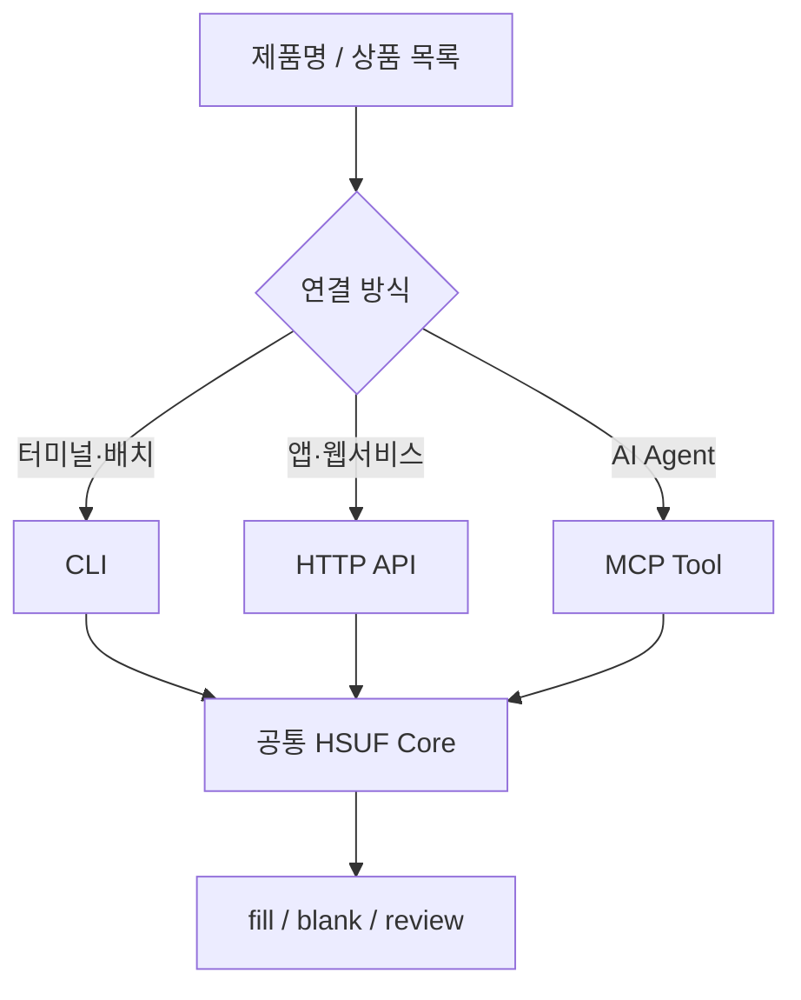
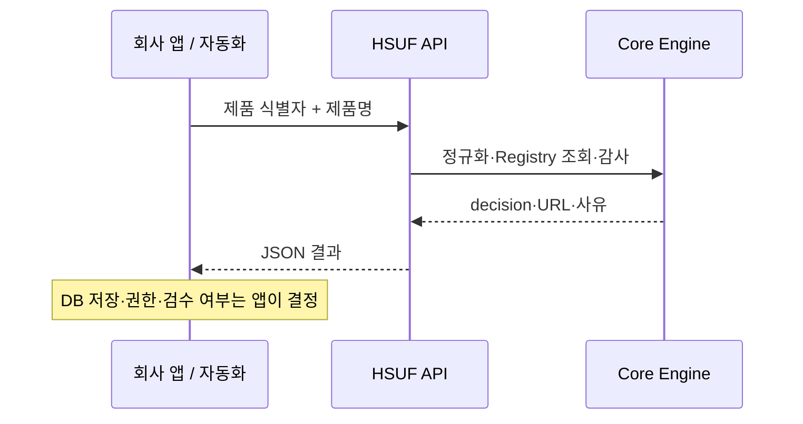

# 프로그램에서 HSUF 사용하기 — CLI, HTTP API, MCP

제품 하나를 확인하는 데는 CLI면 충분합니다. 별도 웹서비스나 자동화 프로그램에 붙이려면 **HTTP API 또는 MCP**를 사용할 수 있습니다. 어떤 방식이든 같은 Core 판정을 받습니다.



## 공통 입력

`product_name`은 필수이고, `input_id`와 `category`, `metadata`는 선택입니다.

```json
{
  "input_id": "SKU-001",
  "product_name": "[ASUS] PRIME A520M-K ARGB",
  "category": "motherboard"
}
```

`input_id`는 소속 회사의 SKU, CSV 행 번호, 자체 UUID를 넣어도 됩니다. HSUF는 이 값을 제품명이나 검색 근거로 해석하지 않고 결과에서 다시 돌려줍니다. 알 수 없는 최상위 입력 필드는 거절합니다.

결과 객체에는 `decision`, `primary`, `secondary`, `reason_codes`, `evidence`, `verified_at`이 포함됩니다. [JSON Schema](../schemas/result.schema.json)에서 정확한 형식을 확인할 수 있습니다.

## 1. CLI — 가장 쉬운 시작

```bash
node bin/hsuf.mjs resolve "[ASUS] PRIME A520M-K ARGB" --offline
node bin/hsuf.mjs resolve examples/generic-catalog.csv --offline --output result.csv
node bin/hsuf.mjs resolve examples/generic-catalog.csv --offline --legacy --output legacy.csv
node bin/hsuf.mjs registry validate
```

`--legacy` CSV는 `input_id,product_name,url` 세 열만 만듭니다. `blank`와 `review` 모두 URL 칸이 비어 있으므로 이 구분이 필요하면 기본 CSV 결과를 사용하세요.

`--config FILE`로 파이프라인 YAML을 지정하거나 `--pipeline serpapi-openai-judge`를 사용할 수 있습니다. 둘 다 지정하지 않으면 기본 Offline이며, `--offline`을 함께 주면 Pipeline 설정이 있어도 외부 조사를 실행하지 않습니다.

입력 CSV는 UTF-8(BOM 허용), **최대 1,000행 / 4 MiB**입니다. 기존 출력 파일을 덮어쓰지 않습니다. 잘못된 인자/파싱 실패는 종료 코드 2로 처리하며, 단순 `review`는 오류 종료가 아닙니다.

조회 외에 다음 명령도 제공합니다.

```bash
node bin/hsuf.mjs audit "https://www.asus.com/motherboards-components/motherboards/prime/prime-a520m-k-argb/helpdesk_download?model2Name=PRIME-A520M-K-ARGB" --name "[ASUS] PRIME A520M-K ARGB"
node bin/hsuf.mjs registry build
node bin/hsuf.mjs discovery import examples/discovery.json
```

`audit`은 페이지를 가져오지 않는 정적 검사이며, 결과는 `verdict: pass | review` 형식입니다. `registry build`는 Registry 검증 후 `data/public/registry.compiled.json`을 생성하므로 [Registry 기여 작업](registry.md)에서 사용합니다. `discovery import`는 JSON/CSV의 `product_name`과 `discovery_url`을 읽어 발견용 후보로 정리합니다. 쇼핑몰을 접속하거나 Registry에 등록하지 않으며, `final_url`은 항상 `null`입니다.

## 2. HTTP API — 다른 프로그램에서 호출

서버 실행:

```bash
node bin/hsuf.mjs serve --port 8787
```

기본 주소는 `http://127.0.0.1:8787`입니다. 별도의 서버 설치나 DB가 필요하지 않습니다.

**curl 요청 예시:**

```bash
curl -X POST http://127.0.0.1:8787/v1/resolve \
  -H "Content-Type: application/json" \
  -d '{"input_id":"SKU-001","product_name":"[ASUS] PRIME A520M-K ARGB"}'
```

PowerShell에서는 JavaScript `fetch` 예제가 셸의 인용 규칙 차이를 피하는 데 편할 수 있습니다.

```js
const response = await fetch('http://127.0.0.1:8787/v1/resolve', {
  method: 'POST',
  headers: { 'content-type': 'application/json' },
  body: JSON.stringify({ input_id: 'SKU-001', product_name: '[ASUS] PRIME A520M-K ARGB' })
});
console.log(await response.json());
```

### 엔드포인트

| 요청 | 경로 | 용도 |
|---|---|---|
| `GET` | `/health` | 서버 상태 / 버전 |
| `POST` | `/v1/resolve` | 제품 1개 Offline 조회 |
| `POST` | `/v1/resolve/batch` | `{ "items": [...] }` 배열을 Offline 일괄 판정 |
| `POST` | `/v1/audit` | `{ "url": "...", "product": {"product_name":"..."} }` 정적 감사 |
| `GET` | `/v1/vendors/:id` | 공개 Vendor 조회 |
| `GET` | `/v1/ecosystems/:id` | 공개 Ecosystem 조회 |
| `POST` | `/v1/research` | 온라인 Provider를 서버 시작 시 설정한 경우에만 사용 |

> [!IMPORTANT]
> 서버가 온라인 Pipeline으로 시작되었더라도 **기본 `/v1/resolve`와 `/v1/resolve/batch`는 Offline**입니다. 외부 API 요금이 발생할 수 있는 온라인 조사는 별도 `/v1/research`에서 실행합니다.

온라인 조사 기능을 별도로 켜려면:

```bash
node bin/hsuf.mjs serve --port 8787 --pipeline serpapi-openai-judge
```

요청 본문 최대 **1 MiB**, 배치 최대 **1,000개**, 동시 요청 기본 **2개**입니다. 오류는 민감정보를 포함하지 않는 `error` 코드로 응답하며, 대표적으로 `INVALID_REQUEST`(400), `UNAUTHORIZED`(401), `BODY_TOO_LARGE`(413), `BUSY`(429)가 있습니다.

외부 네트워크 인터페이스에 서버를 열려면 `HSUF_HTTP_TOKEN` 등 인증 설정이 필요합니다. **공개 인터넷 서비스로 사용할 때 TLS/Reverse Proxy/Rate Limit/접근 제어까지 자동으로 제공되는 제품은 아닙니다.** 운영 환경 보안은 구축하는 조직의 책임입니다. [보안 문서](../SECURITY.md)를 확인하세요.

## 3. MCP — AI Agent용 도구

```bash
node bin/hsuf.mjs mcp
```

MCP는 터미널 화면에 결과를 출력하는 일반 프로그램이 아닙니다. **MCP 클라이언트와 표준 입출력(stdio)으로 통신**하므로 Agent에서 서버를 실행하도록 연결해야 합니다.

기본 Tool은 다음 6개입니다.

| Tool | 하는 일 |
|---|---|
| `resolve_hardware_software_url` | 제품 하나 조회 |
| `resolve_hardware_software_urls` | 제품 여러 개 조회 |
| `audit_hardware_software_url` | 특정 후보 URL 검사 |
| `lookup_hardware_vendor` | 공개 제조사 Registry 정보 |
| `lookup_software_ecosystem` | 공개 소프트웨어 생태계 정보 |
| `get_registry_status` | Registry 상태·버전 |

온라인 조사 옵션을 주면 별도 `research_hardware_software_url` Tool이 생깁니다. 기본 조회 Tool은 그대로 Offline입니다. → [Agent Skill/MCP 설정 예제](AGENTS.md)

## API와 HSUF의 경계



HSUF는 어떤 DB에 결과를 저장할지 결정하거나 사내 인증·ERP 연동을 구현하지 않습니다. → [조직 연동 문서](integration.md)

[← 문서 길잡이](README.md) · [5분 시작하기](quick-start.md) · [Provider 계약](providers.md)
