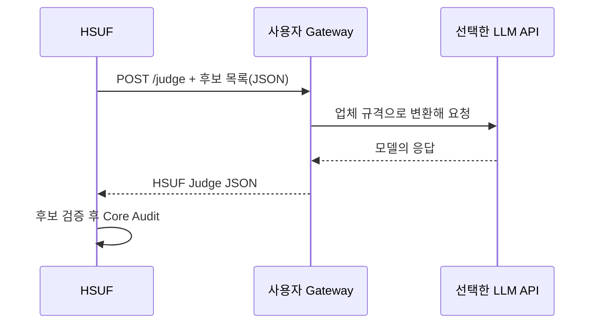

# Search Provider와 Judge Provider 연결 규격

이 문서는 **자기 서비스의 검색 API나 LLM을 HSUF에 붙이려는 개발자**를 위한 문서입니다. 단순히 SerpAPI+OpenAI를 사용하려면 [온라인 조사 예제](provider-recipes.md)부터 읽는 편이 쉽습니다.

## 둘을 왜 나눴나요?

예를 들어 SerpAPI는 **후보 주소를 찾는 역할**이고, OpenAI는 **후보들 중 어떤 것이 더 적절한지 비교하는 역할**입니다. 이 역할이 분리되어 있으면 업체를 바꿔도 Core 판정 규칙은 그대로 유지할 수 있습니다.


> [!IMPORTANT]
> **Provider의 결과는 신뢰되지 않는 후보 데이터**입니다. Provider가 `fill`이라고 주장하거나 URL을 새로 만들어도 Core의 최종 판정을 덮어쓸 수 없습니다.

## Search Provider

HSUF가 Search Provider에 전달하는 요청에는 정규화한 제조사/모델/카테고리, 검색어 및 최대 결과 수가 들어갑니다.

```json
{
  "product": { "vendor": "example", "model": "ABC V2", "category": "keyboard" },
  "query": "Example ABC V2 software support site:example.com",
  "limit": 20
}
```

Search Provider는 다음처럼 후보 URL·제목·요약을 돌려줍니다.

```json
{
  "candidates": [
    {
      "url": "https://example.com/support/abc-v2",
      "title": "ABC V2 Support",
      "snippet": "Driver download"
    }
  ]
}
```

`example.com` 주소와 모델은 **설명용 가상 예시**입니다. 실제 검증된 제품 URL이 아닙니다.

HSUF는 후보를 다시 검증하고 안정적인 후보 ID를 부여합니다. Search 응답이 제공한 임의의 `official: true` 같은 표시를 최종 근거로 사용하지 않습니다.

## 점수는 최종 판정이 아닙니다

HSUF는 후보가 공식 도메인인지, 모델명이 보이는지, 지원 페이지인지 등을 평가합니다. **Hard Reject** 항목(쇼핑몰, 커뮤니티, 직접 설치 파일, 잘못된 리비전)은 점수와 상관없이 먼저 차단합니다.

- 점수 정책: [`config/scoring.yaml`](../config/scoring.yaml)
- 기본 상위 후보 수: **5**, 설정 가능 범위 **1~20**
- 공개 설정 예제: [`serpapi-openai-judge.example.yaml`](../examples/serpapi-openai-judge.example.yaml)

## Judge Provider

Judge는 **새 URL을 작성하는 기능이 아닙니다.** HSUF가 정리해서 넘긴 후보 ID 중 하나를 고르거나 `review`를 제안합니다.

```json
{
  "decision": "candidate",
  "candidate_id": "1",
  "reason_codes": ["EXACT_MODEL"],
  "uncertainties": []
}
```

확신할 수 없다면:

```json
{
  "decision": "review",
  "candidate_id": null,
  "reason_codes": ["REVISION_AMBIGUOUS"],
  "uncertainties": ["V1과 V2의 공식 지원 범위가 구분되지 않음"]
}
```

알 수 없는 후보 ID, 정의되지 않은 JSON 필드나 추가 URL을 반환하면 계약 검증에서 거절됩니다. Judge의 후보 선택 이후에도 **Core가 해당 공식 웹페이지를 독립적으로 Fetch·Audit**합니다.

## 기본 제공 연결 방식

| 역할 | v0.1.0 구현 | 필요한 준비 |
|---|---|---|
| Search | Mock | 테스트 전용, 키 불필요 |
| Search | SerpAPI | `SERPAPI_API_KEY` |
| Search | Generic HTTP | `HSUF_SEARCH_ENDPOINT` 및 선택적 token |
| Judge | Mock | 테스트 전용 |
| Judge | OpenAI Responses | `OPENAI_API_KEY`, `OPENAI_MODEL` |
| Judge | Generic HTTP | `HSUF_JUDGE_ENDPOINT` 및 선택적 token |
| Judge | Command | 운영자가 지정한 로컬 실행 명령 |

**Gemini·DeepSeek·Qwen·Claude API로 연결하기:** 이들 서비스를 HSUF가 직접 제공하는 네이티브 SDK는 아닙니다. 사용자가 만든 Gateway에서 업체별 API 요청/응답을 HSUF 규격으로 변환해야 합니다.



> Generic HTTP 목적지의 **localhost나 사설 IP는 네트워크 보호 정책으로 차단**됩니다. 로컬 머신에서만 실행하는 Judge가 필요하다면 운영자 지정 `Command` 방식 또는 API 구조를 별도로 설계해야 합니다. 보안 검사를 끄는 방식으로 우회하지 마세요.

## Command Judge 사용

[`examples/command-judge.example.yaml`](../examples/command-judge.example.yaml)은 고정된 실행 파일에 JSON을 stdin으로 보내고 stdout JSON을 받아 Judge 계약으로 검증하는 예제입니다.

Shell 문자열을 평가하지 않고 제한된 환경변수만 전달합니다. 따라서 실행 명령은 **운영자가 신뢰하는 프로그램**이어야 합니다. 임의 검색결과나 사용자 입력으로 명령 실행 파일을 지정하지 마세요.

## 비용과 오류 처리

Registry에서 해결되면 외부 Provider를 건너뜁니다. 나머지에 대해서만 Search가 수행되고, 필요할 때 Judge가 호출됩니다. Provider 시간 초과·요금/인증 오류·잘못된 응답은 `review`로 처리되며 `blank`가 되지 않습니다.

기본 테스트는 가짜 HTTP 응답을 넣어 실제 Provider 구현을 검증했습니다. **유료 API 실계정 호출은 v0.1.0 공개 검증 범위에 포함되지 않았습니다.**

[← 문서 길잡이](README.md) · [온라인 조사 따라 하기](provider-recipes.md) · [보안 정책](../SECURITY.md)
