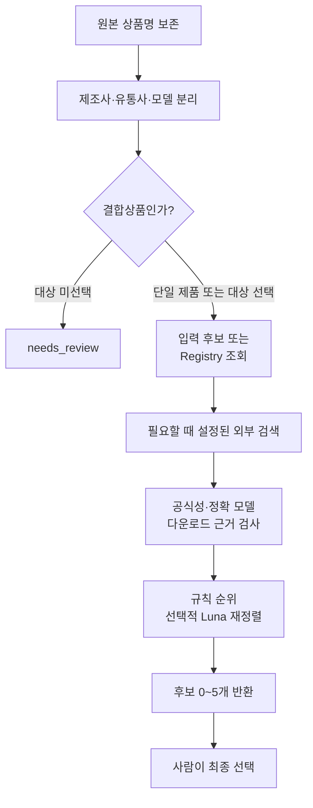

# 처리 흐름

외부 `candidates`가 있으면 그 목록을 사용하고 새 검색은 하지 않는다.
외부 후보가 없을 때는 Registry를 조회한다.
검색은 온라인 모드에서 Provider가 설정된 경우에만 실행한다.
결합상품은 `target_component`로 검수할 구성품을 먼저 지정한다.

공식 도메인, 정확 모델·리비전, 요청한 SW 유형, 실제 다운로드 근거를 확인한다.
접속 차단, Provider 실패, 모델 불명확은 `needs_review`로 남긴다.
Luna는 전달된 후보 ID의 순위만 평가한다.

모든 결과는 `approved=false`다.
최종 선택과 저장을 연결하는 방법은 [연동 계약](integration.md)을 따른다.
