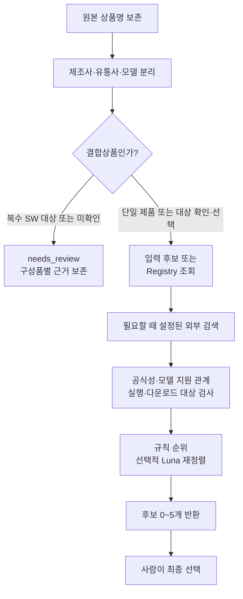

# 처리 흐름

외부 `candidates`가 있으면 그 목록을 사용하고 새 검색은 하지 않는다.
외부 후보가 없을 때는 Registry를 조회한다.
검색은 온라인 모드에서 Provider가 설정된 경우에만 실행한다.
결합상품은 구성품마다 SW 대상 여부를 확인한다.
SW 대상이 하나이고 나머지 구성품의 SW 없음이 확인된 경우만 자동으로 선택한다.
`target_component`로 검수할 구성품을 직접 지정할 수도 있다.

공식 도메인, 정확 모델·리비전, 요청한 SW 유형, 실제 다운로드 근거를 확인한다.
접속 차단, Provider 실패, 모델 불명확은 `needs_review`로 남긴다.
Luna는 전달된 후보 ID의 순위만 평가하며 확인된 한국어·지원 정책을 뒤집지 않는다.

모든 결과는 `approved=false`다.
최종 선택과 저장을 연결하는 방법은 [연동 계약](integration.md)을 따른다.
