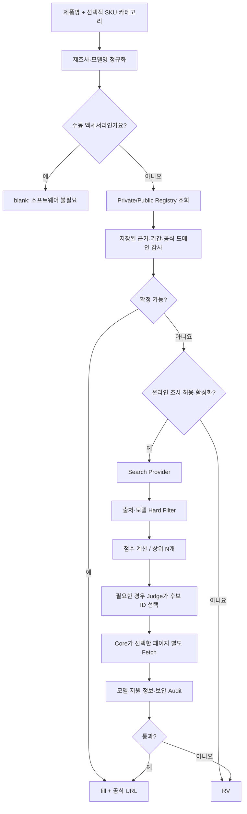
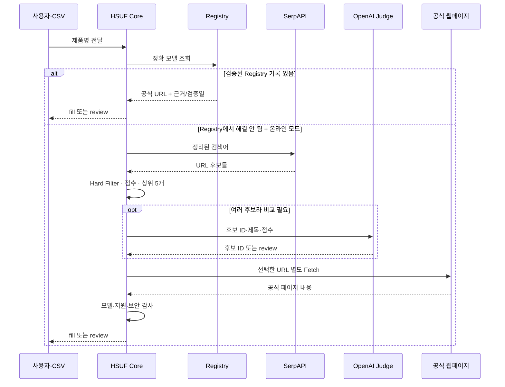
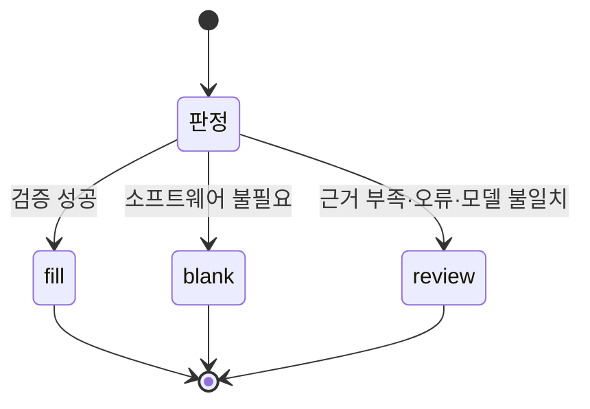

# HSUF는 어떻게 URL을 고를까요?

제품명을 검색하면 1위에 뜨는 링크가 그 제품의 공식 지원 페이지라고 생각하기 쉽습니다. 실제로는 **모델 버전, 제조사, 지원 프로그램, 출처가 서로 다른 URL**이 섞여 있습니다. HSUF는 이 문제를 두 단계로 나눕니다. **먼저 알고 있는 정보를 확인하고, 모르는 제품만 조사**합니다.

## 전체 판정 순서

**그림에서 중요한 부분은 두 곳입니다.** 처음의 Registry 단계에서는 이미 검증된 근거를 재사용해 비용을 줄입니다. 온라인 조사 단계에서는 AI가 고른 URL조차 Core가 마지막으로 확인합니다.

Registry에서 `review`가 나와도 온라인 모드라면 다시 조사할 수 있습니다. 다만 지원 종료·대체·권장 중단, 명시적 제외·미지원 판정은 그대로 유지합니다. Private Overlay의 미확정 결과도 기본적으로 외부 조사에 보내지 않습니다.

### 1. 제품명 정리

`[ASUS] PRIME A520M-K ARGB`처럼 쓰인 상품명에서 제조사 `ASUS`와 모델 `PRIME A520M-K ARGB`를 구분합니다.

`D4`/`D5`, `V2`, `WiFi`, `Pro` 같은 차이는 지원 프로그램이 달라질 수 있으므로 **근거 없이 삭제하지 않습니다.** 색상·국내 유통사명도 모든 브랜드에서 무조건 제거하지 않습니다.

### 2. Registry 조회

Registry는 제조사 공식 도메인, 확인한 모델 지원 페이지, 소프트웨어 호환 모델, 별칭과 검증일을 저장합니다.

여기서 가장 헷갈리기 쉬운 점은 **'공식 사이트를 안다'와 '해당 제품을 지원한다'는 다르다**는 것입니다. 브랜드 등록만 되어 있어도 정확 모델 근거가 없다면 `review`가 나올 수 있습니다.

### 3. 검색과 점수제

온라인 조사가 허용되고 Search Provider가 설정된 경우에만 외부 검색을 합니다. 찾은 URL 중 쇼핑몰·커뮤니티·직접 설치 파일·명백한 다른 리비전 후보는 점수와 관계없이 차단합니다.

나머지 후보는 공식 도메인, 정확 모델 표기, 지원/다운로드 페이지 여부 등으로 점수를 계산합니다. 점수는 **후보를 좁히는 보조 지표**입니다. 점수가 높다고 최종 정답은 아닙니다.

### 4. LLM Judge (선택)

공식 페이지가 여러 개라 사람처럼 내용을 비교해야 할 때 Judge가 상위 후보의 **ID를 선택**합니다. 새로운 URL을 만들어 반환하는 것은 허용하지 않습니다. 애매한 부분이 있다면 `review`를 제안할 수 있습니다.

### 5. Core의 최종 감사

온라인 조사에서는 Judge가 선택한 공식 페이지를 Core가 **독립적으로 다시 가져옵니다.** 공식 도메인인지, 리다이렉트한 주소가 안전한지, HTML에 정확 모델과 소프트웨어 관련 근거가 있는지 검사합니다. 페이지에 접근할 수 없으면 URL을 추측하지 않습니다.

반대로 Offline Registry 조회에서는 웹페이지를 새로 Fetch하지 않습니다. 저장된 근거와 날짜, URL 정책을 확인합니다. 따라서 `fill`을 '실시간 사이트 연결 보증'과 혼동하면 안 됩니다.

## 검색과 AI가 실제로 주고받는 것

**검색 API가 없으면 `review`**라는 뜻이지, 제품에 소프트웨어가 없다는 뜻이 아닙니다.

## 어떤 오류를 막으려고 하나요?

| 실수하기 쉬운 사례 | HSUF의 처리 방향 |
|---|---|
| `ABC` 대신 `ABC V2` 링크를 고름 | 리비전 차이를 확인하고 충돌 시 차단 |
| 제조사 이름만 같은 다른 제품 페이지 | URL·페이지 본문에서 모델 근거 확인 |
| 쇼핑몰에 있는 드라이버 첨부 파일 | 최종 URL로 사용하지 않음 |
| 공식 프로그램 페이지지만 내 장치 지원 여부 불명확 | `review` 유지 |
| 사이트 접속 차단/WAF 오류 | '소프트웨어 없음'이 아닌 `review` |
| 오래전에 확인한 URL | 검증일/수명주기 정책에 따라 재확인 |

> [!IMPORTANT]
> Core가 하는 일은 **정해둔 근거·정책을 일관되게 적용하는 것**입니다. 웹페이지가 정보를 누락하거나 JavaScript로만 모델을 보여주는 경우처럼 자동 검사에 한계가 있는 상황은 사람 검수로 넘깁니다.

### 세 가지 결과의 차이

실제로는 `reason_codes`, `evidence`, `verified_at`을 결과와 함께 반환합니다. 업무용 시스템은 URL뿐 아니라 **상태와 이유도 함께 보관**하는 편이 좋습니다.

[← 전체 문서](README.md) · [검색 + LLM 예제](provider-recipes.md) · [Registry 알아보기](registry.md)
